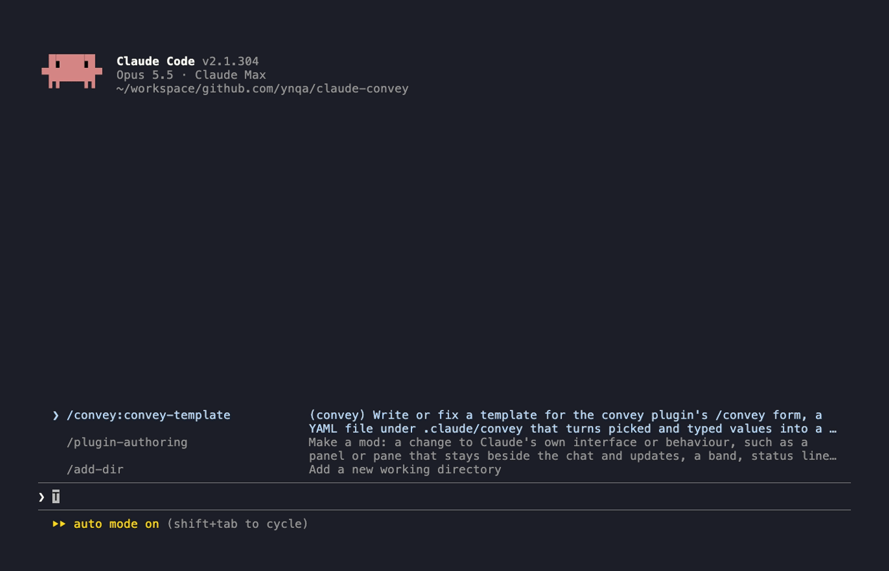

# claude-convey

[English](README.md) | [日本語](README.ja.md)



[convey](https://github.com/ynqa/convey) にインスパイアされた Claude Code のプラグインです。

## 背景

エージェントに頼む作業には、推測させたくない値があります。例えば、作業の対象や環境、
バージョンなどです。プロンプトに書き漏らすと、エージェントは手元の情報から推測して進めます。
推測が外れると、違う相手に対して作業をしてしまいます。

かといって、毎回正確な名前を手で打つのは手間で、打ち間違いも起きます。

convey では、こうした値を人がフォームで選んでからプロンプトにします。

- 選択肢をコマンドの出力から作れるので、実際にある値から選べて、打ち間違いが起きない
- よく頼む作業のプロンプトをテンプレートにしておけるので、毎回同じ形で頼める
- プロンプトは送信されずに入力欄に入るので、送る前に中身を確かめられる

## 実行の流れ

1. `.claude/convey/` に、入力欄とプロンプトの形を書いたテンプレート（YAML）を置く
2. `/convey` を実行すると、Claude Code の中にフォームが開く
3. 選択肢から選んだり、文を書いたりして値を埋める。選択肢は固定のリストのほか、
   `git` や `kubectl` などのコマンドの出力からも作れる
4. **Fill** を押すと、値を埋めたプロンプトが Claude Code の入力欄に入る
   （送信はしないので、確かめてから送れる）

## 必要なもの

- Claude Code（プラグインの Mod の機能が使えるもの）
- テンプレートが候補を取るのに使うコマンド（例のテンプレートでは `git`、`kubectl`）
- フォームが使える環境
  - ターミナル、デスクトップアプリ、VS Code: 使える
  - モバイル: 使えない（フォームの代わりに「使えない」という 1 行が表示される）

## インストール

```sh
claude plugin marketplace add ynqa/claude-convey
claude plugin install convey@claude-convey
```

Claude Code の中では、次のコマンドでも入れられます。

```sh
/plugin marketplace add ynqa/claude-convey
/plugin install convey@claude-convey
```

入れたあと、セッションを始め直すと読み込まれます。

## 使い方

### テンプレートを置いて開く

使いたいプロジェクトの `.claude/convey/` に、テンプレートを置きます。

- 書き方：[テンプレートの書き方](#テンプレートの書き方)
- 例：[examples/](examples/)
- Claude Code に書かせる：[テンプレートを作るスキル](#テンプレートを作るスキル)

Claude Code で `/convey` を実行すると、フォームが開きます。

- `/convey`：`.claude/convey/` のテンプレートを読み込む
- `/convey path/to/dir`：指定したディレクトリのテンプレートを読み込む
- `/convey path/to/template.yaml`：指定したファイルだけを読み込む

読み込めなかったファイルは、返答に `skipped <パス>: <理由>` と出ます。

### フォーム

フォームは `convey` と `preview: <テンプレート名>` の 2 つのタブで開きます。

- **template**：テンプレートが 2 つ以上あるときは、ここで切り替えます
- **入力欄**：値が入った欄には `✓`、まだの欄には `○` が付きます。黄色の `*` は必須の欄です
- **コマンドの候補**
  - 前の欄の値を待っている間は `waiting for …`、取得中は `loading…` と出ます
  - 前の欄を選び直すと、それに依存する欄は消えて取り直しになります
  - 取得に失敗すると、エラーの 1 行目と **Retry** が出ます（`▸` で全文を開けます）
- **Fill**：まだ空いている必須の欄があると、横に `Required: …` と出ます
- **preview タブ**：Fill で入る文をその場で表示します。埋まった値は緑、
  まだの値は黄色の `‹名前›` で出ます

### キー操作

| キー | 動き |
| --- | --- |
| Tab / Shift+Tab | 次の要素 / 前の要素へ |
| ↑ ↓、Enter | 選択欄で選ぶ |
| Enter（テキスト欄） | 値を確定して、次の欄へ |
| ctrl+x tab | タブを切り替える（convey ↔ preview） |
| Esc | フォームを閉じる（preview タブも一緒に閉じる） |

## テンプレートの書き方

```yaml
name: git-commit-review          # 選択欄とプレビューのタブに出る名前

inputs:                          # フォームの欄。書いた順に並ぶ
  branch:
    type: select                 # 選択肢から選ぶ
    candidates:
      command:                   # コマンドの出力の 1 行が 1 つの候補
        program: git
        args: [branch, --format=%(refname:short)]

  commit:
    type: select
    allow_empty: false           # 必須（既定は true = 空でもよい）
    depends_on: [branch]         # branch を選ぶまで待ち、選び直すと消える
    candidates:
      command:
        program: git
        args: [log, --format=%h %s, -n, "20", "{{ inputs.branch }}"]

  request:
    type: textarea               # 自由に書く欄

output:
  template: |                    # Mustache。値は {{ inputs.<名前> }} で入る
    # Commit review

    - Branch: `{{ inputs.branch }}`
    - Commit: {{ inputs.commit }}

    {{ inputs.request }}
```

### フィールド

| フィールド | 説明 |
| --- | --- |
| `name` | テンプレートの名前（必須） |
| `inputs` | 欄の定義。キーが欄の名前で、1 つ以上必要 |
| `inputs.<名前>.type` | `select`（選ぶ）か `textarea`（書く） |
| `inputs.<名前>.allow_empty` | `false` で必須。既定は `true` |
| `inputs.<名前>.candidates.values` | select の固定の選択肢（文字列のリスト） |
| `inputs.<名前>.candidates.command` | select の候補を出すコマンド（`program` と `args`） |
| `inputs.<名前>.depends_on` | 値を待つ select の名前のリスト |
| `output.template` | プロンプトの形（必須） |

select の `candidates` には、`values` か `command` のどちらか片方を書きます。
ここにないフィールドを書くと、エラーになります。

### コマンドの候補

- `program` を直接起動し、`args` の各要素を 1 つずつ引数として渡します。シェルは挟まないので、
  パイプ（`|`）、`&&`、`$VAR`、`~` などを使うときは、`program` を `sh` にして `-c` でスクリプトを渡します。
  欄の値はスクリプトに埋め込まず、引数で渡して `"$1"`、`"$2"` で受け取ります

  ```yaml
  command:
    program: sh
    args:
      - -c
      - kubectl --context "$1" get pods -o json | jq -r '.items[].metadata.name'
      - sh                       # $0 に入る名前（何でもよい）
      - "{{ inputs.context }}"   # $1
  ```
- `program` と `args` の中で `{{ inputs.<名前> }}` が使えます。展開して空になった引数は落とします
- 出力の空でない 1 行が、前後の空白を除いて 1 つの候補になります。その行がそのまま値になります
- 終了コードが 0 以外のとき、または 30 秒を超えたときは、エラーとして Retry が出ます
- `args` で使う欄は、すべて `depends_on` に書きます。`depends_on` に書けるのは、
  自分より前にある select だけです

### プロンプトの形（output.template）

[Mustache](https://mustache.github.io/) で書きます。値はエスケープされず、入力したとおりに入ります。

- `{{ inputs.<名前> }}`：その欄の値。空なら何も入りません
- `{{#inputs.<名前>}}…{{/inputs.<名前>}}`：値があるときだけ中身を出します
- `{{^inputs.<名前>}}…{{/inputs.<名前>}}`：値がないときだけ中身を出します

```yaml
output:
  template: |
    {{#inputs.namespace}}
    - Namespace: `{{ inputs.namespace }}`
    {{/inputs.namespace}}
```

## テンプレートを作るスキル

プラグインには、テンプレートを書くための `convey-template` スキルが入っています。
Claude Code に頼むと、何を毎回選びたいかを聞き、候補を出すコマンドを実際に試してから、
`.claude/convey/` にテンプレートを書きます。

頼み方の例です。

```
git のブランチとコミットを選んで、そのコミットのレビューを頼む convey のテンプレートを作って
```

```
kubectl のコンテキスト、namespace、Pod を順に選んで、Pod が落ちている原因の調査を頼む
テンプレートを作って。調べてほしい内容は毎回自由に書きたい
```

書き終えたら、`/convey .claude/convey/<名前>.yaml` で開けるか確かめてください。
`skipped` と出たときは、その内容を Claude に伝えると直してくれます。
